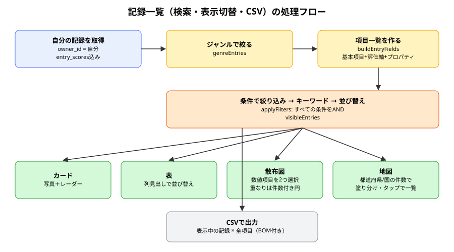
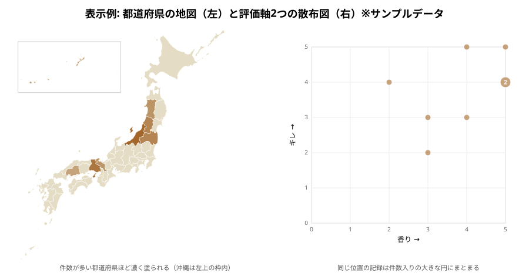

# entries_views 説明書

> 対象コード: `src/pages/EntriesPage.tsx`, `src/lib/entryFields.ts`, `src/lib/csv.ts`, `src/components/FilterBuilder.tsx`, `src/components/EntriesTable.tsx`, `src/components/ScatterPlot.tsx`, `src/components/RegionMap.tsx`, `scripts/generate-maps.mjs`（コミット: ec381d4）
> 対象読者: 作成者本人（学習目的）
> 前提知識レベル: アプリ開発初心者（DB・SQL・Reactいずれも初めて）
> 記述方針: 専門用語は初出のたびにかみ砕いて説明する

---

## 0. この文書の読み方・前提知識

- [[entries_list_knowledge|記録一覧の説明書]]の「取得したデータをアプリ側で絞り込む」考え方。今回はそれを一般化している。
- [[properties_knowledge|プロパティの説明書]]の`entries.properties`（都道府県・温度などの値）。

### 用語集

| 用語 | 意味（平易な説明） | 初出章 |
|---|---|---|
| フィールド（項目） | 「対象名」「日付」「コシ（評価軸）」「都道府県（プロパティ）」など、記録から取り出せる1つの値の種類 | 3 |
| 散布図 | 横軸と縦軸に2つの数値をとり、記録を点として並べた図。2つの値の関係が見える | 3 |
| コロプレス図（塗り分け地図） | 地域ごとの数量を色の濃さで表した地図 | 3 |
| SVG | 線や図形を「座標と命令」で表す画像形式。`<path d="M10,20 L30,40 ...">`のように書く | 3 |
| 投影（プロジェクション） | 丸い地球の緯度経度を、平らな画面の座標に変換する計算 | 3 |
| CSV | 値をカンマで区切って並べたテキスト形式の表。Excelやスプレッドシートで開ける | 3 |
| BOM | ファイル先頭に付ける目印の文字。これがあると、Excelが日本語を文字化けせずに読める | 5 |

---

## 1. このコードで何をするか（概要）

記録一覧に、Obsidian Basesのような「項目×条件」を自由に組み合わせる絞り込みを追加した。表示方法も「カード」「表」「散布図（評価軸2つ）」「地図（都道府県・国）」から選べるようにし、絞り込んだ結果をCSVファイルとして書き出せるようにした。

---

## 2. 背景・なぜこれが必要か

- プロパティ（都道府県・温度など）を入れられるようになったが、「新潟県の日本酒だけ」「温度10℃以下で香り4以上」のように、**プロパティや評価軸で探す手段**がなかった。
- 「評価軸を2つ選んで図を描きたい」「都道府県が入っていたら日本地図で見たい」という要望があった。どの県にどの記録があるかが一目でわかると、記録の偏りや次に行きたい場所が見えてくる。
- 「データをCSVで出力したい」という要望があった。スプレッドシートで自由に集計したり、バックアップとして手元に残したりできる。

---

## 3. 設計思想・アーキテクチャの考え方



### 3.1 すべての機能を「フィールド」という共通部品で作る

検索条件・表の列・散布図の軸・CSVの列は、どれも「記録から何か1つの値を取り出す」という点で同じである。そこで`buildEntryFields`で、記録から取り出せる項目の一覧をまず作る。

```ts
{ id: 'axis:コシ', label: 'コシ', kind: 'number', get: (entry) => コシのスコア }
{ id: 'prop:都道府県', label: '都道府県', kind: 'choice', get: (entry) => '新潟県', choices: [...] }
```

各フィールドは「名前」「種類（text / number / date / choice）」「記録から値を取り出す関数`get`」を持つ。検索も表もCSVも、この`get`を呼ぶだけで済む。新しいプロパティが増えても、どの機能も自動的に対応する。

### 3.2 絞り込みは「すべての条件を満たす」（AND）

条件は「項目」「値」「条件の種類」の3つで1行。種類はフィールドの`kind`に応じて変わる（文字なら「を含む」、数値なら「≧」など）。複数の条件は、**すべて満たす記録だけ**を残す（AND）。「または」（OR）はわかりにくくなるので今回は入れていない。値がまだ空の条件は、入力途中とみなして無視する。

### 3.3 散布図: 重なる点を1つの円にまとめる

評価は1〜5のような整数なので、点がまったく同じ位置に重なりやすい。重なったままだと「1件に見えて実は5件」になってしまう。そこで同じ座標の記録をまとめ、件数に応じて円を大きくし、件数を数字で表示する。円の半径は件数の平方根に比例させている（面積が件数に比例するので、見た目の大きさと件数が釣り合う）。

### 3.4 地図: 投影の計算はビルド前に済ませておく

地図データ（TopoJSON）は、地域の境界を緯度経度の点の列で持っている。画面に描くには、それを平面の座標に**投影**し、SVGの`<path>`命令に変換する必要がある。この計算をブラウザで毎回すると、変換用のライブラリ（d3-geo）と大きな地図データを毎回ダウンロードすることになる。

そこで`scripts/generate-maps.mjs`で、**変換済みのSVGパス文字列**をJSONに書き出しておき、アプリはそれを表示するだけにした。さらに、地図を開いたときに初めて読み込む（`import()`による遅延読み込み）ので、地図を見ない人の表示速度には影響しない。

- 日本地図: 元データは細かすぎる（760KB）ため、形を簡略化して93KBにした。また、小笠原諸島を除き、沖縄を左上の枠内に移した（一般的な日本地図と同じ配置）。こうしないと、本州が画面の中で小さくなってしまう。
- 世界地図: Natural Earth図法（世界全体がほどよい形に見える投影法の1つ）で描いた。国名は国コードから日本語名に変換している。

### 3.5 CSV: Excelで文字化けしないように

CSVは単純なテキストだが、2つの決まりを守る必要がある。(1) カンマ・改行・`"`を含む値は全体を`"`で囲み、中の`"`は`""`と2つ重ねる。(2) Excelは、BOMがないUTF-8のファイルを文字化けして開くため、先頭にBOMを付ける。

---

## 4. 実装の考え方（コードと概念の対応）

| 概念 | コード上の対応 | 補足 |
|---|---|---|
| フィールド | `EntryField`型 / `buildEntryFields()` | 基本項目＋評価軸＋プロパティ |
| 検索条件1行 | `FilterCondition`（`fieldId, op, value`） | `OPS_BY_KIND`で種類ごとの条件を定義 |
| AND絞り込み | `applyFilters()` | `every`で全条件を満たすか判定 |
| 表示方法 | `viewMode`（cards / table / scatter / map） | 表示方法と条件はlocalStorageに保存 |
| 点のまとめ | `ScatterPlot`内の`Map<"x,y", 記録[]>` | 半径 = 5 + √(件数−1) × 4 |
| 塗り分け | `RegionMap`の`fillFor()` | 件数/最大件数で、アクセント色の濃さ35〜100% |
| 地図データ | `src/data/japanMap.json`, `worldMap.json` | `generate-maps.mjs`で生成 |
| CSV | `buildCsv()` / `downloadCsv()` | BOM付きUTF-8、改行はCRLF |

### 主要な設計判断
- **判断**: 絞り込みはDBではなくアプリ側で行う
  **理由**: 自分の記録だけが対象で件数が多くないこと、JSONBの中のプロパティを任意の条件で検索するSQLを組み立てるより単純で安全なこと
  **他の選択肢**: Supabaseのクエリで絞り込む（件数が非常に多くなったら検討）
- **判断**: 地図の色はテーマ変数（`--rf-accent`）を`color-mix`で薄めて作る
  **理由**: 4つのテーマのどれでも、そのテーマのアクセント色で塗り分けられる
- **判断**: 地図に描けない小さな国も、地図の下の一覧には出す
  **理由**: 世界地図の縮尺では、シンガポールのような小さな国は形がない。一覧に出さないと記録が「消えた」ように見える

---

## 5. コードの読み方（ステップ・バイ・ステップ）

```ts
// EntriesPage.tsx
const genreEntries = useMemo(() => (selectedGenreId ? entries.filter(...) : entries), ...)
const fields = useMemo(() => buildEntryFields(genreEntries), [genreEntries])
let result = applyFilters(genreEntries, fields, conditions)
```

まずジャンルで絞り、その記録の集合から使える項目（フィールド）を作る。ジャンルを選ぶと、そのジャンルの評価軸とプロパティだけが選択肢に出る。

```ts
// csv.ts
const blob = new Blob(['\uFEFF', csv], { type: 'text/csv;charset=utf-8' })
link.download = filename
link.click()
```

`\uFEFF`がBOM。ファイルの中身をメモリ上で作り（Blob）、一時的なリンクをクリックさせることでダウンロードさせる。

---

## 6. 具体例で動きを追う

日本酒の記録が3件あるとする。

| 対象名 | 都道府県 | 温度 | 香り | キレ |
|---|---|---|---|---|
| A | 新潟県 | 10 | 4 | 5 |
| B | 新潟県 | 15 | 4 | 5 |
| C | 兵庫県 | 8 | 3 | 3 |

1. 条件「温度 [12] ≦」→ AとCが残る。
2. 散布図（横: 香り、縦: キレ）にすると、Aは(4,5)、Cは(3,3)の点になる。条件を外すとAとBが(4,5)で重なり、「2」と書かれた大きめの円になる。
3. 地図（都道府県）にすると、新潟県が2件で最も濃く、兵庫県が1件でやや薄く塗られる。新潟県をタップすると、AとBが下に一覧表示される。
4. 「CSVで出力」を押すと、`対象名,ジャンル,日付,タグ,コメント,公開設定,香り,キレ,都道府県,温度`という見出しで、表示中の記録が書き出される。



---

## 7. つまずきやすいポイント・よくある誤解

- **ジャンルを混ぜたまま散布図を見ると比べにくい**: 「すべて」のままだと、別ジャンルの評価軸も選べてしまう。画面上でジャンルを1つ選ぶよう案内している。
- **地図が出ないのはプロパティが無いから**: 地図は「都道府県」型か「国」型のプロパティがある記録だけが対象。テキスト型で「新潟県」と入れても地図には載らない。
- **条件は端末に保存される**: 次に開いたときも条件が残っているので、「記録が少ない？」と感じたら条件を確認する。

---

## 8. 確認問題

1. 検索条件・表・散布図・CSVを、同じ`EntryField`で作ると何がうれしいか。
   - 解答: プロパティや評価軸が増えても、どの機能も追加の修正なしに対応できる。
2. 散布図で、重なった点の円の半径を件数の平方根に比例させるのはなぜか。
   - 解答: 円の面積は半径の2乗に比例するので、半径を√件数に比例させると、面積（見た目の大きさ）が件数に比例する。
3. 地図の投影計算をビルド前に済ませておく利点を2つ挙げよ。
   - 解答: (1) ブラウザに変換ライブラリを読み込ませずに済む。(2) 簡略化したデータだけを配信でき、通信量が減る。
4. CSVの先頭にBOMを付ける理由は何か。
   - 解答: ExcelがUTF-8として正しく認識し、日本語が文字化けしないようにするため。

---

## 9. さらに学ぶために

- d3-geo（投影とSVGパスの生成）、TopoJSON（境界線を共有して軽くする地図データ形式）
- Natural Earth（世界地図の元データ）、国土地理院「地球地図日本」（日本地図の元データ、jpn-atlas経由）
- RFC 4180（CSVの書式）
