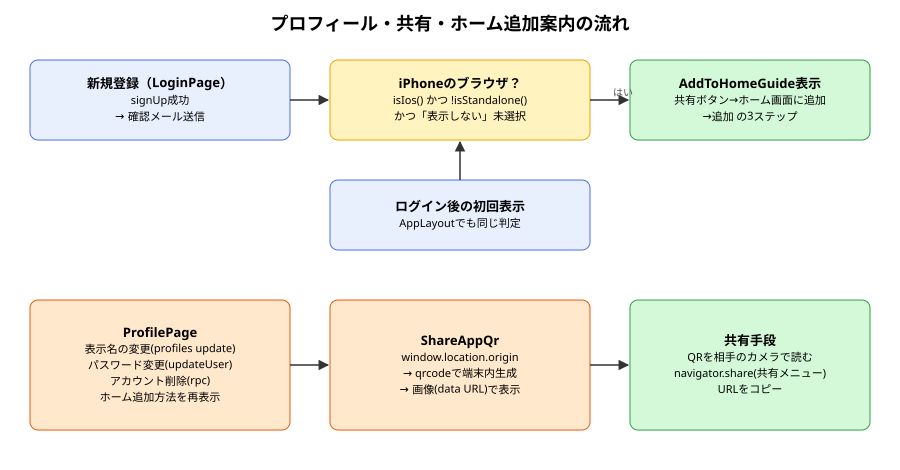
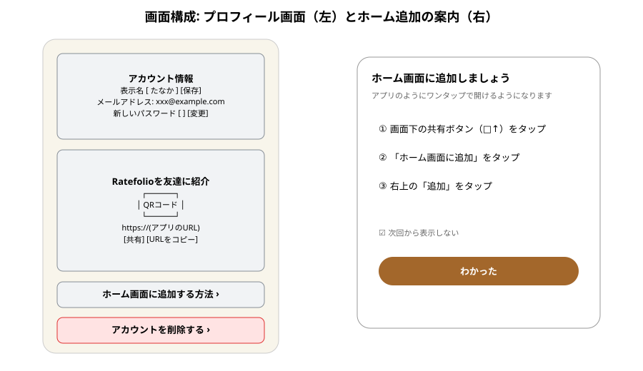

# profile 説明書

> 対象コード: `src/pages/ProfilePage.tsx`, `src/components/ShareAppQr.tsx`, `src/components/AddToHomeGuide.tsx`, `src/lib/pwa.ts`, `src/components/AppLayout.tsx`, `src/pages/LoginPage.tsx`, `src/pages/HomePage.tsx`（コミット: 07abfc7）
> 対象読者: 作成者本人（学習目的）
> 前提知識レベル: アプリ開発初心者（DB・SQL・Reactいずれも初めて）
> 記述方針: 専門用語は初出のたびにかみ砕いて説明する

---

## 0. この文書の読み方・前提知識

- [[auth_knowledge|認証の説明書]]の、Supabase Authによるログインと`profiles`テーブル（表示名）の関係。
- `profiles`のRLS: 自分の行だけ更新できる（`profiles_update_own`）。

### 用語集

| 用語 | 意味（平易な説明） | 初出章 |
|---|---|---|
| QRコード | 文字列（今回はURL）を白黒の四角い模様にしたもの。カメラで読み取ると元の文字列に戻る | 1 |
| data URL | 画像などの中身そのものを`data:image/png;base64,...`という文字列で表したURL。外部にファイルを置かずに画像を表示できる | 3 |
| Web Share API（`navigator.share`） | スマホの「共有メニュー」（LINE・メールなどを選ぶ画面）をWebページから開く仕組み | 3 |
| PWA / ホーム画面に追加 | WebアプリをスマホのホームにアイコンとしてInstallし、アプリのように全画面で開けるようにすること | 3 |
| standalone表示 | ホーム画面のアイコンから開いた状態（ブラウザのアドレスバーがない状態） | 3 |
| localStorage | ブラウザに小さなデータを保存しておける場所。端末ごと・ブラウザごとに別々 | 3 |

---

## 1. このコードで何をするか（概要）

ヘッダーから開けるプロフィール画面を作り、表示名・パスワードの変更、アカウント削除をまとめた。プロフィール画面では、アプリのURLをQRコードで表示し、友達にすぐ紹介できるようにした。さらに、iPhoneのブラウザで開いている人には「ホーム画面に追加」の手順をポップアップで案内する。

---

## 2. 背景・なぜこれが必要か

- 表示名は新規登録時に決めたきりで、あとから変える手段がなかった。
- 対面で「このアプリ使ってみて」と勧めるとき、URLを口頭で伝えたり、メッセージで送ったりするのは手間がかかる。QRコードなら、相手がカメラをかざすだけで開ける。
- iPhoneでは、アプリ側から「ホーム画面に追加」ボタンを出す方法がない（Androidにはある）。Safariの共有メニューの中にある「ホーム画面に追加」を、利用者が自分で探して押す必要がある。手順を知らない人が多いため、登録時に案内することにした。

---

## 3. 設計思想・アーキテクチャの考え方



### 3.1 QRコードは端末の中で作る

QRコードを作る無料のWebサービス（URLを送ると画像を返してくれるもの）もあるが、それを使うと**URLが第三者のサーバーに送られる**。また、サイトのセキュリティ設定（CSP）で外部の画像を許可する必要も出てくる。そこで、`qrcode`ライブラリでスマホの中でQRコードを作り、data URL（画像の中身を文字列にしたもの）として``に表示している。

QRコードは、テーマが暗い配色のときでも**白地に黒**で表示する。白黒が反転していると読み取れないカメラアプリがあるためである。

### 3.2 共有ボタンは、使える端末でだけ出す

`navigator.share`（共有メニュー）はスマホではほぼ使えるが、PCのブラウザでは使えないことがある。そこで、使える場合だけ「共有」ボタンを出し、どの端末でも使える「URLをコピー」ボタンは常に出している。

### 3.3 ホーム追加の案内を出す条件

次の3つをすべて満たすときだけ案内を出す。

1. iPhone／iPadである（`isIos()`）。iPadは最近「Mac」と名乗るため、「Macなのにタッチ操作ができる」場合もiPadと判定する。
2. まだホーム画面から開いていない（`!isStandalone()`）。すでに追加済みの人に案内しても意味がない。
3. 「次回から表示しない」を選んでいない（localStorageに記録）。

出すタイミングは2つある。(a) 新規登録が完了した直後（確認メールを送った画面）、(b) ログイン後に初めてアプリの画面を開いたとき。(a)だけだと、PCで登録してスマホでログインした人に案内が届かないためである。案内を閉じたあとも、プロフィール画面の「ホーム画面に追加する方法」からいつでも見直せる。

### 3.4 アカウント削除をホームからプロフィールへ移動

アカウント削除はホーム画面の一番下にあった。「アカウントに関する設定」はプロフィール画面にまとめたほうが探しやすく、ホームで誤って押す危険も減るため移動した。処理の中身（写真を先に消してから、DB関数`delete_own_account`を呼ぶ）は変えていない。

---

## 4. 実装の考え方（コードと概念の対応）

| 概念 | コード上の対応 | 補足 |
|---|---|---|
| 表示名の変更 | `supabase.from('profiles').update(...).eq('id', user.id)` | RLSで自分の行しか更新できない |
| パスワード変更 | `supabase.auth.updateUser({ password })` | 8文字以上（登録時と同じ基準） |
| QRコード | `QRCode.toDataURL(url)` → `` | URLは`window.location.origin` |
| 共有 | `navigator.share()` / `navigator.clipboard.writeText()` | 共有メニューを閉じただけの場合のエラーは無視 |
| 案内の表示判定 | `shouldShowAddToHomeGuide()` | iOS・非standalone・未dismiss |
| 案内の非表示記録 | `dismissAddToHomeGuide()` | localStorageの`rf-a2hs-guide-dismissed` |

### 主要な設計判断
- **判断**: QRに載せるURLは`window.location.origin`（今開いているサイトのURL）にする
  **理由**: URLを決め打ちにすると、ドメインを変えたときに直し忘れる。開いているサイトそのものを共有すれば常に正しい
- **判断**: 「次回から表示しない」のチェックは最初からオンにする
  **理由**: 毎回出ると煩わしい。見直したい人のために、プロフィールに入口を残した

---

## 5. コードの読み方（ステップ・バイ・ステップ）

```ts
// pwa.ts
export function isStandalone() {
  const nav = navigator as Navigator & { standalone?: boolean }
  return nav.standalone === true || window.matchMedia('(display-mode: standalone)').matches
}
```

iPhoneのSafariは、ホーム画面から開かれると`navigator.standalone`が`true`になる（Safari独自の機能）。ほかのブラウザ向けに、標準の`display-mode: standalone`も合わせて確認している。

```tsx
// AppLayout.tsx
const [showGuide, setShowGuide] = useState(() => shouldShowAddToHomeGuide())
```

`useState`に関数を渡すと、最初の1回だけその関数が実行されて初期値になる。画面を開いた時点で「案内を出すべきか」を1度だけ判定している。

---

## 6. 具体例で動きを追う

1. 先輩がiPhoneのSafariで新規登録 → 「確認メールを送信しました」と同時に案内のポップアップが開く。
2. 「わかった」を押す（「次回から表示しない」はオンのまま）→ localStorageに記録され、以後は自動で出ない。
3. 手順どおりホーム画面に追加し、アイコンから開く → `isStandalone()`が`true`になり、案内の入口もプロフィールから消える。
4. 飲み会で友達に勧める → プロフィール画面のQRを見せ、友達がカメラで読み取ってRatefolioを開く。



---

## 7. つまずきやすいポイント・よくある誤解

- **Safariのプライベートブラウズ**: localStorageが使えない場合、「次回から表示しない」が記録されず、案内が毎回出る可能性がある（エラーで止まらないよう`try/catch`はしている）。
- **iPhoneのChromeなど、Safari以外のブラウザ**: iOS 16.4以降は共有メニューから追加できるが、ボタンの位置がSafariと異なる。案内文は「Safariで開いている場合の手順」と明記している。
- **表示名を変えると公開記録の投稿者名も変わる**: 記録側には表示名を複製していないため（`profiles`から毎回読む）、過去の公開記録にも新しい名前が表示される。

---

## 8. 確認問題

1. QRコードを外部サービスではなく端末内で作る理由を2つ挙げよ。
   - 解答: (1) URLが第三者に送られない。(2) CSPで外部画像を許可しなくて済む。
2. iPadを判定するのに「Macintoshかつタッチ対応」を見るのはなぜか。
   - 解答: iPadOSのSafariは、PC版サイトを表示するためにMacとして名乗るから。
3. ホーム追加の案内を、新規登録時とログイン後の初回表示の2か所で出すのはなぜか。
   - 解答: 登録した端末とアプリを使う端末が違う場合（PCで登録してスマホで使うなど）にも案内を届けるため。

---

## 9. さらに学ぶために

- MDN: Web Share API、`Clipboard.writeText()`、`display-mode`メディア特性
- Apple: Configuring Web Applications（ホーム画面に追加したWebアプリの挙動）
- qrcode（npm）のドキュメント
