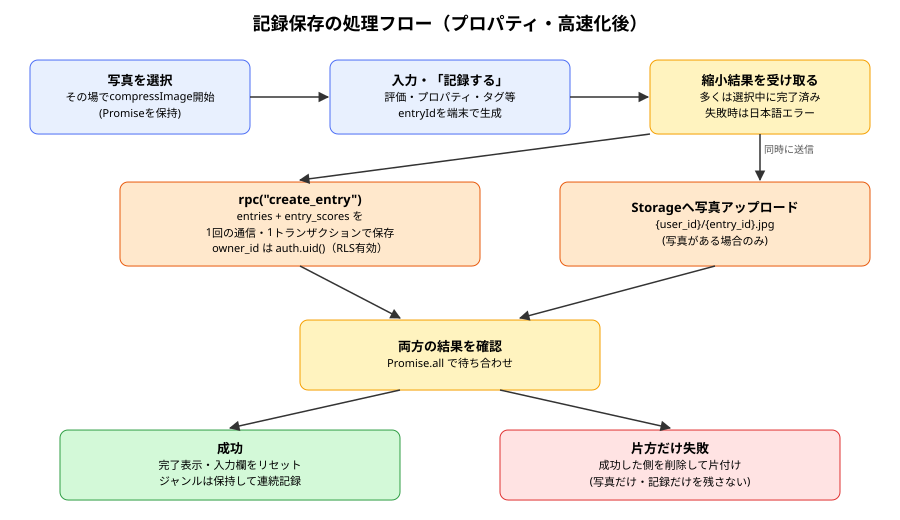
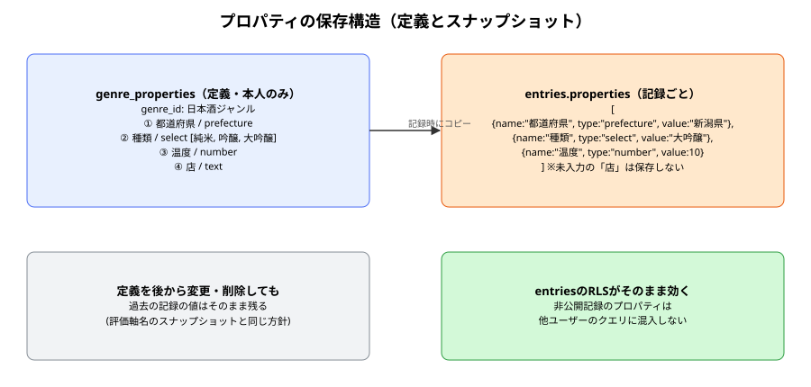

# properties 報告書

| 項目 | 内容 |
|---|---|
| 作成日 | 2026-10-19 |
| 対象コード | `supabase/migrations/0005_properties_and_fast_save.sql`, `src/lib/properties.ts`, `src/lib/compressImage.ts`, `src/components/PropertyDefinitionsEditor.tsx`, `src/components/PropertyInputs.tsx`, `src/pages/GenrePropertiesPage.tsx`, `src/pages/NewGenrePage.tsx`, `src/pages/NewEntryPage.tsx`, `src/pages/EditEntryPage.tsx`（コミット: 17a354d, 1645b11） |
| 作成者 | Claude Code |
| 版数 | v1.0 |

## 改訂履歴
| 版 | 日付 | 変更内容 |
|---|---|---|
| v1.0 | 2026-10-19 | 初版作成 |

---

## 1. 目的・対象読者

本報告書は、Ratefolioに追加したプロパティ機能（ジャンルごとの任意項目の定義と記録への入力）、記録保存の高速化、および写真追加の不具合修正の内容を共有することを目的とする。対象読者は本プロジェクトの技術的な引き継ぎ先を想定する。

## 2. 背景

利用者から次の3点の改善要望を受けた。

- 都道府県・店・温度・純米/大吟醸などの付帯情報を、型を選んで自由に追加したい（Obsidianのプロパティ相当）。都道府県と国は地図表示と連動する既定の型として用意したい。
- 記録の保存の待ち時間を短くしたい。
- 一部の利用者の端末で写真の追加に失敗する（端末の種類は不明）。

## 3. 数学的・物理的な前提知識

本機能に数学的な前提知識はない。設計上の前提は次のとおりである。

- RLS（Row Level Security）: 行ごとの読み書き権限をDBが強制する仕組み。`entries`は「本人、または公開フラグがtrue」の行のみ読める。
- スナップショット方針: 記録作成時にジャンル名・評価軸名を記録側へ複製する既存方針（0001_init.sql）。プロパティも同方針とする。
- トランザクション: 関数内の複数の書き込みは、すべて成功するか、すべて取り消される。

## 4. 仕様

### 4.1 入力仕様

| 項目名 | 型 | 説明 | 制約 |
|---|---|---|---|
| プロパティ名 | text | 例: 都道府県, 温度 | 必須。同一ジャンル内で重複不可（アプリ側で検査） |
| プロパティ型 | text | `text` / `number` / `select` / `prefecture` / `country` | DBのcheck制約で5種に限定 |
| 選択肢 | text[] | `select`型の候補 | `select`型では1つ以上必須。他の型では空配列 |
| プロパティ値 | string または number | 記録ごとの入力値 | 未入力は保存しない。`number`型は数値に変換できる値のみ |
| 写真 | File | 記録に添付する画像 | 縮小後またはそのままの状態で5MB以下 |

### 4.2 出力仕様

| 項目名 | 型 | 説明 |
|---|---|---|
| `genre_properties` | テーブル | `id, genre_id, name, type, options, sort_order, created_at` |
| `entries.properties` | jsonb（配列） | `[{name, type, value}, ...]`。check制約で配列であることを保証 |
| `create_entry(p_entry, p_scores)` | uuid | 記録とスコアを1トランザクションで作成し、記録IDを返す |
| `update_entry(p_id, p_entry, p_scores)` | void | 記録本体と変更のあったスコアを1トランザクションで更新する |

### 4.3 制約条件・前提条件

- `0005_properties_and_fast_save.sql`をSupabaseで実行済みであること。未実行の場合、記録の作成・編集は失敗する。
- 国の選択肢は`i18n-iso-countries`の日本語名（約250件）を、ビルド前のスクリプトで`src/data/countries.json`に書き出したものを使う。

## 5. 使用ライブラリ・実行環境情報

| 項目 | 内容 |
|---|---|
| 言語/バージョン | TypeScript 6.0 / React 19 / PostgreSQL（Supabase） |
| 主要ライブラリ | @supabase/supabase-js : 2.112 ／ i18n-iso-countries : 7.14（開発時のみ） |
| 実行環境 | ブラウザ（iOS Safari / Android Chrome / PC）、Vercel、Supabase（東京リージョン） |
| 実行方法 | SQL EditorでSQLを実行した後、`npm run build`してVercelへデプロイする |

## 6. アルゴリズム

記録作成時の処理は次のとおりである。

1. 写真選択時に`compressImage`を開始し、Promiseを保持する。
2. 保存時に`entryId`を端末で生成し、保持したPromiseの結果（縮小後の画像）を受け取る。
3. 写真のアップロードと`create_entry`の呼び出しを`Promise.all`で同時に実行する。
4. `create_entry`は`entries`を挿入（`owner_id = auth.uid()`）し、`p_scores`を展開して`entry_scores`を一括挿入する。
5. どちらか一方のみ失敗した場合は、成功した側（記録または写真）を削除して整合性を保つ。

写真の縮小は次の順で試みる。

1. `createImageBitmap`（向き補正つき）で読み込む。失敗したら``要素で読み込む。
2. 長辺1280pxに縮小してJPEG化する。元より小さいか、元がブラウザで表示できない形式（HEIC等）であればJPEGを使う。
3. 読み込みに失敗した場合は、5MB以下であれば元のファイルを使い、超える場合は形式・サイズを含む日本語エラーを出す。

## 7. フローチャート



## 8. 実装

| 関数/クラス | 役割 |
|---|---|
| `genre_properties`（SQL） | プロパティ定義。RLSは「ジャンルの所有者のみ」 |
| `create_entry` / `update_entry`（SQL） | 保存処理を1回の通信・1トランザクションにまとめる。`security invoker`でRLSを維持する |
| `entry_photos_select_own_or_public`（SQL） | Storage閲覧ルール。自分のフォルダ、または公開記録の写真のみ閲覧可 |
| `buildPropertyFields` | ジャンルの定義と保存済みの値を合わせ、入力欄の配列を作る |
| `fieldsToEntryProperties` | 入力欄を保存用のスナップショット配列へ変換する（空欄は除外、数値型は数値化） |
| `PropertyDefinitionsEditor` | プロパティ定義の追加・並べ替え・削除UI。都道府県・国・店・価格のプリセットを持つ |
| `PropertyInputs` | 型に応じた入力欄（プルダウン／数値／テキスト）を表示する |
| `GenrePropertiesPage` | 既存ジャンルのプロパティを編集する（削除とupsertを並行実行） |
| `compressImage` / `describeUploadError` | 端末差に強い縮小処理と、アップロードエラーの日本語化 |

## 9. 出力結果

プロパティの定義と、記録へ保存されるスナップショットの例を示す。



## 10. 妥当性検証

| 検証項目 | 方法 | 結果 | 判定 |
|---|---|---|---|
| 型チェック・ビルド | `tsc -b` / `npm run build` | エラーなし | 合格 |
| 非公開のプロパティが他人に見えないか | 設計レビュー（値は`entries`の列であり、既存RLSの対象） | 新たな公開経路はない | 合格（実データの複数アカウント確認は未実施） |
| DB関数で他人の記録を書き換えられないか | 設計レビュー（`security invoker`、`owner_id = auth.uid()`、`update`は`owner_id = auth.uid()`で絞り込み） | RLSと条件の二重で防止 | 合格（実DBでの攻撃試験は未実施） |
| Storage閲覧ルールの変更で他人の写真が見えないか | 設計レビュー（追加条件は「フォルダ名 = 自分のID」のみ） | 他人の非公開写真は従来どおり見えない | 合格（実DB確認は未実施） |
| 保存の待ち時間の短縮 | 未計測 | — | 要実機計測 |
| 写真の不具合が解消したか | 未確認（報告者の端末が不明で再現できていない） | — | 要実機確認 |
| migration 0005 の適用 | 未実施（本報告書の作成時点） | — | 要適用 |

## 11. 既知の制限事項・今後の課題

- プロパティ名を変更すると、作成済みの記録は旧名のまま残るため、一覧の列が新旧で分かれる。一括で名前を置き換える機能は未実装である。
- 選択肢型は単一選択のみで、複数選択（タグのような使い方）には未対応である。
- 写真の不具合の根本原因は特定できていない。報告者の端末で再現した場合は、表示されるエラー文（形式・サイズを含む）から原因を確定させる。

## 12. 総括

ジャンルごとに5種類の型からプロパティを定義し、記録へスナップショットとして保存する仕組みを実装した。値を`entries`の列に持たせることで、既存のRLSのみで公開/非公開の制御を保っている。保存処理は、写真の事前縮小、写真と記録の並行送信、DB関数による通信の一本化で待ち時間を短縮した。写真の不具合には、端末差が出やすい5つの箇所すべてに対策を施した。

## 13. 参考文献

- Supabase Docs: Database Functions / Storage Access Control
- PostgreSQL Documentation: JSON Functions and Operators
- MDN Web Docs: `createImageBitmap()`, `HTMLImageElement.decode()`, `Promise.all()`

---

## Appendix. コード実例

```sql
create or replace function public.create_entry(p_entry jsonb, p_scores jsonb)
returns uuid
language plpgsql
security invoker
set search_path = public
as $$
declare
  v_id uuid := coalesce((p_entry ->> 'id')::uuid, gen_random_uuid());
begin
  insert into public.entries (id, owner_id, genre_id, genre_name, scale_max, target_name,
    entry_date, comment, tags, is_public, photo_path, properties)
  values (v_id, auth.uid(), (p_entry ->> 'genre_id')::uuid, p_entry ->> 'genre_name', ...);

  insert into public.entry_scores (entry_id, axis_id, axis_name, sort_order, score)
  select v_id, (s ->> 'axis_id')::uuid, s ->> 'axis_name',
         (s ->> 'sort_order')::smallint, (s ->> 'score')::smallint
  from jsonb_array_elements(p_scores) as s;

  return v_id;
end;
$$;
```
